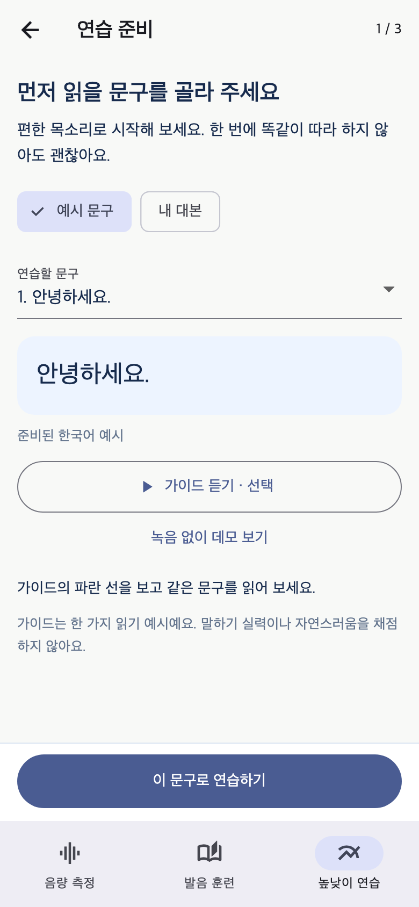
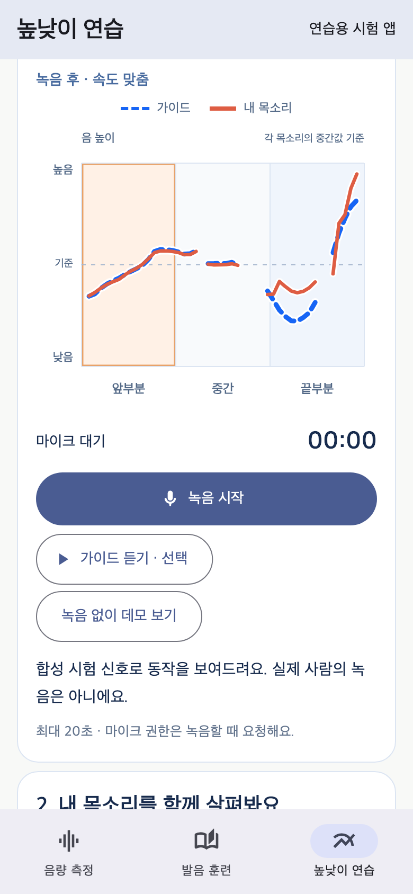
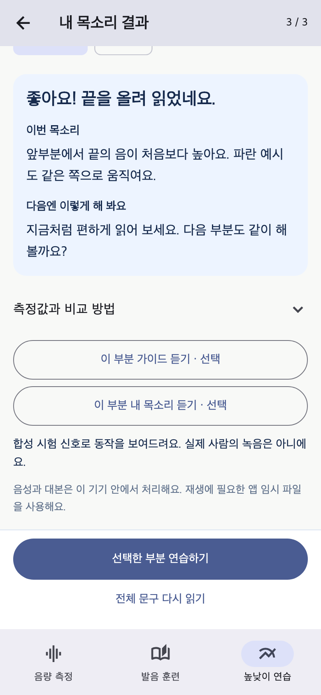

# 높낮이 연습: PR 검토 안내

작성: 2026-11-03 · 담당: 영수(3번 기능) · 이번 작업 범위: 높낮이 기능 코드와 브랜치/PR

이 문서는 높낮이 기능 PR의 검토 자료다. **main 브랜치에는 병합하지 않았으며, 최종 통합과 병합은 홍건표가 담당한다.** 공용 앱의 연결 코드는 PR에서 검토할 제안이다.

VoiceMate의 주기능은 **대화 중 실시간 목소리 크기 확인**이다. 높낮이 연습은 사용자가 별도 탭을 선택했을 때만 사용하는 보조 기능이다. 청각장애 사용자가 같은 대본의 읽기 예시를 보고, 자신의 목소리 높낮이와 상대 크기 변화를 비교하며 연습한다. Android는 Flutter 화면·녹음·분석으로 직접 구현하며 WebView를 사용하지 않는다. 웹 경로는 같은 사이트에 포함한 브라우저용 연습 화면을 사용한다. 발음 정답률이나 말하기 능력을 채점하지 않는다.

## 팀별 작업 경계

| 구분 | 담당 | 기능과 통합 경계 |
|---|---|---|
| 1 | 홍건표 | 상황별 음량 측정과 환경음 대응. 기존 `SessionController`·음량 입력 경로 담당 |
| 2 | 제욱 | 발음 퀴즈, 내 문장 읽기, 복습. `features/pronunciation` 담당 |
| 3 | 영수 | 대본별 읽기 예시, 실시간 높낮이 그래프, 녹음 비교와 구간 재연습. `features/prosody` 담당 |

발음 퀴즈와 높낮이 연습은 별도 기능이다. 기존 발음 훈련의 문항·규칙·복습 기록을 높낮이 분석에 사용하지 않는다. 공용 진입점과 의존성 변경은 통합에 필요한 부분만 PR에서 함께 확인한다.

## 통합 담당자가 확인할 마이크 사용 경계

- 공용 앱의 기본 진입점과 실시간 음량 기능의 최종 연결은 홍건표가 결정한다. 이번 PR은 `main.dart`의 기존 진입 동작을 변경하지 않으며, `app.dart`의 높낮이 탭 연결은 통합 검토용 제안이다.
- 높낮이 탭을 열 때 준비된 예시 파일을 읽을 수 있지만, 마이크·예시 음성 재생·새 TTS 가이드 생성을 자동 시작하지 않는다. 각각 사용자가 해당 동작을 선택해야 시작한다.
- 음량 측정 중 높낮이 탭으로 이동하면 기존 입력 종료를 기다린다. 높낮이 녹음 중 음량 측정으로 돌아가면 연습 녹음·가이드 생성·재생 종료를 기다린 뒤 화면을 전환한다. 기다리는 동안에는 기존 화면에서 녹음을 다시 시작할 수 없다.
- 같은 앱 실행 중에는 가이드와 받아들인 비교 결과를 유지한다. 어느 탭으로 돌아오더라도 이전 녹음을 자동 재개하지 않는다.

이 경계는 PR에서 제안하는 **기능 간 연결 규칙**이다. 현재 공용 코드의 음량 입력은 웹에서 `web_audio_port.dart`, 네이티브에서 `unsupported_audio_port.dart`를 선택한다. 네이티브 음량 입력과 환경음 대응의 이식·검증은 1번 기능 담당 홍건표의 작업이며, 이번 높낮이 PR은 해당 구현을 변경하지 않는다. Android 실시간 음량 측정은 이 PR에서 구현·검증한 기능으로 설명하지 않는다.

## 사용 흐름

1. **연습 준비**: 준비된 예시 3개 중 하나를 고르거나 대본을 입력한다. 직접 입력한 문구는 **한국어 가이드 만들기**를 눌러 기기 TTS의 WAV를 만들고, 그 WAV를 실제로 분석해 그래프를 준비한다. 글자에 임의의 높낮이 곡선을 붙이지 않는다. 예시 듣기는 선택 기능이다.
2. **목소리 녹음**: **이 문구로 연습하기**를 누르면 녹음 화면으로 이동한다. 이때 마이크는 아직 켜지지 않는다. **녹음 시작**을 눌러 최대 20초 읽는다. 녹음 화면에는 문구·그래프·녹음 조작을 모으고, 이전 결과를 새 녹음 선처럼 표시하지 않는다.
3. **내 목소리 결과**: 분석 가능한 새 녹음이 받아들여지면 결과 화면으로 이동한다. 예시와 읽기 속도를 대략 맞춘 그래프, 선택 구간의 관찰 내용과 다음 연습 방법을 확인한다. 측정 근거를 확보할 수 있는 1~3개 시간 구간을 사용하며, 문구에 따라 구간 수가 달라진다. **선택한 부분 연습하기** 또는 **전체 문구 다시 읽기**로 녹음 화면에 돌아가도 마이크는 자동 시작하지 않는다.

대본은 최대 2,000자이며 문장부호·줄바꿈과 100자 길이 기준으로 최대 30개 문구로 나눈다. 준비·녹음·결과는 서로 다른 화면 단계이며, 기존 비교 결과는 실패한 재시도나 녹음 취소로 덮어쓰지 않는다.

아래는 Flutter로 렌더링한 준비·녹음·결과 화면이다. 음성 선은 합성 시험 입력이며 실제 Android 기기에서 녹음한 캡처가 아니다.

| 준비 | 녹음 | 결과 |
|---|---|---|
|  |  |  |

숫자 점수, 합격/불합격, 임의의 목표 높낮이 선택 메뉴는 제공하지 않는다. 가이드는 해당 TTS의 **한 가지 읽기 예시**이며 모든 사용자에게 적용되는 정답 억양은 아니다.

## 파일 구조

아래 경로는 모두 `apps/client/` 기준이다.

| 경로 | 역할 |
|---|---|
| `lib/features/prosody/presentation/prosody_screen.dart` | 대본 입력, 녹음, 비교 결과와 구간 연습 화면 |
| `lib/features/prosody/practice_session.dart` | 예시 선택·생성, 녹음 상태, 분석·비교, 구간 재연습 흐름 |
| `lib/features/prosody/practice_feedback.dart` | 측정 근거 확인과 부담을 줄인 구간별 연습 안내 |
| `lib/features/prosody/audio/` | 순수 Dart YIN·RMS·DTW 분석과 WAV 인코딩/디코딩 |
| `lib/features/prosody/services/device_audio.dart` | 네이티브 마이크, 기기 TTS, 재생, 임시 파일 정리 |
| `lib/features/prosody/widgets/prosody_chart.dart` | 예시·내 목소리 선, 음성 공백, 선택 구간 표시 |
| `assets/prosody/guides/` | `hello.wav`, `sunglasses.wav`, `phrase.wav` 준비된 예시 3개 |

PR의 연결 제안에서는 `app.dart`의 하단 **높낮이 연습** 탭으로 진입한다. 음량 측정에서 이동할 때 기존 마이크를 멈추고, 높낮이 화면을 떠나거나 앱이 배경으로 가면 녹음·재생·가이드 생성을 정리한다. 마이크를 두 기능이 동시에 소유하지 않도록 이 경계를 유지한다. 웹에서는 같은 사이트의 높낮이 연습 화면을 열어 브라우저에서 녹음·분석한다. 가로 단계 이동과 대본 전체 가이드 생성 등 웹 동작은 [웹 지원과 대본 가이드](prosody-web-feedback.md)를 참고한다.

## 그래프와 안내가 만들어지는 원리

| 단계 | 현재 구현 | 해석할 때 주의할 점 |
|---|---|---|
| 소리 입력 | 16kHz 모노 PCM을 최대 20초 수집 | 마이크 거리·방향·잡음에 영향을 받는다. 다른 사람의 목소리를 구별하지 않는다. |
| 높이·크기 측정 | 50ms 창을 20ms씩 옮기며 YIN으로 기본주파수(F0), RMS로 디지털 소리 크기 계산 | 현재 F0 탐색 범위는 65~500Hz다. 이 범위는 연령별 정상 범위가 아니다. |
| 음성 근거 선택 | 레벨·주기성·연속 프레임 조건으로 비교할 음성 구간 선택 | 무음·무성 자음·불확실한 프레임은 선을 이어 채우지 않는다. 모든 잡음을 제거하는 기능은 아니다. |
| 상대값 변환 | 각 녹음의 중앙 F0를 기준으로 `12 × log₂(F0 / 중앙 F0)` 반음 표시. 크기도 각 녹음의 중앙 dB를 뺀 상대값 사용 | 목소리의 원래 높이와 녹음 게인 차이를 줄여 변화 모양을 본다. 절대 높이나 절대 음량이 같다는 뜻은 아니다. |
| 녹음 뒤 시간 정렬 | 유효 음성 프레임에 DTW를 적용해 서로 다른 읽기 속도를 대략 맞춤 | 음성 인식이나 단어·음절 정렬이 아니다. 실시간 선은 이 정렬을 미리 적용한 결과가 아니다. |
| 구간 선택 | 가이드를 3개, 2개, 1개의 같은 길이 시간 구간으로 나누어 확인하고, 모든 구간에서 측정 근거를 확보하는 가장 세밀한 분할을 선택 | 사용자의 결과가 좋은지에 따라 구간 수를 고르지 않는다. 단어·음절 경계는 아니다. |
| 구간 안내 | 선택 구간의 앞·뒤 1/3 시간대에서 실제로 이어지는 음성 블록을 찾아 대표값 변화 방향을 비교. 가이드와 사용자 양쪽의 프레임·시간·연속성 근거 확인 | 무성 공백을 이어 채우지 않는다. “같은 방향”은 구간 전체가 자연스럽거나 정확하다는 판정이 아니다. 중간의 모든 변화를 평가하지 않는다. |

높낮이 화면의 상대 dB에는 음량 측정 기능의 `+114` 보정값을 더하지 않는다. 실제 dB SPL 측정이나 상황별 적정 음량 판단은 1번 기능의 별도 문제다.

YIN과 DTW는 알려진 신호 처리 방법을 Dart로 구현했다. Python·librosa를 앱 안에서 실행하지 않는다. [YIN 원 논문](https://pubmed.ncbi.nlm.nih.gov/12002874/)은 F0 추정 방법의 근거이고, [librosa의 DTW 문서](https://librosa.org/doc/latest/generated/librosa.sequence.dtw.html)는 시간 정렬 방법을 확인할 수 있는 공개 자료다. 이 자료가 우리 앱의 정확도나 청각장애 사용자의 개선 효과를 입증하는 것은 아니다.

주기성 조건 `0.85`, 최소 프레임 수, 연속 시간, 반올림 단위 등은 측정을 보류하거나 표현하기 위한 구현 조건이다. **정확도 85%, 정상 억양 기준, 임상 평가표로 설명하면 안 된다.** 나이·성별·사투리별 정상화나 발음 정확도 평가는 현재 구현하지 않았다.

구간 안내의 앞·뒤 음성 블록은 각각 서로 다른 프레임 3개 이상, 시간폭 40ms 이상, 인접 프레임 간격 80ms 이하를 요구한다. 구간 전체에서도 유효 프레임 5개 이상과 120ms 이상의 범위가 있어야 하며 앞·뒤 블록이 겹치지 않아야 한다. 안내에는 실제 측정에 쓴 양쪽 시간대가 표시된다. 이 값들은 희박한 관측으로 단정하지 않기 위한 구현 조건이며, 임상적으로 검증한 말하기 평가 기준은 아니다.

## 기기 음성과 데이터 처리

- 직접 입력한 문장의 가이드는 Android에 **이미 설치된 오프라인 한국어 음성**을 확인한 뒤 생성한다. 지원하는 음성이 없거나 WAV 생성에 실패하면 준비된 예시를 사용하도록 안내한다. 기기·TTS 엔진에 따라 예시 음성과 지원 여부가 달라진다.
- 녹음과 생성 음성은 앱의 임시 디렉터리에 저장하고 기기에서 분석한다. 이 기능은 대본·녹음을 서버로 업로드하지 않는다.
- 탭을 바꿀 때 녹음·재생·가이드 생성을 중단하고, 앱 안에서는 이전 결과를 다시 볼 수 있도록 유지한다. 앱의 음성 서비스 종료 시 임시 파일 삭제를 시도한다. 강제 종료 등으로 정리되지 않은 캐시가 남을 가능성은 있으며, 영구 보관·대화 기록 기능은 없다.

## 현재 단계와 확인할 사항

기존 웹 실험의 분석 로직을 네이티브 Flutter 기능으로 옮긴 단계다. 신호 처리 단위 테스트와 상태·화면 테스트는 구현 확인용이며, **실제 Android 마이크·권한·한국어 TTS·백그라운드 전환을 함께 사용하는 실기기 검증은 아직 완료하지 않았다.** 사용자 평가나 재활 효과 검증 결과도 없다.

저장소 기준은 `.flutter-version`의 **Flutter 3.47.7**, 기존 Android 최소 **API 24**다. 별도 실험 앱은 로컬 Flutter 3.47.9에서 작업했지만, 이를 이유로 공용 버전이나 Android 설정을 올리지 않는다. 이번 요청은 코드와 PR까지이며 SDK 설치·APK 제작·배포를 포함하지 않는다.

기존 개발 환경에서 통합 확인:

```sh
cd apps/client
flutter pub get
flutter analyze
flutter test --no-pub
```

탭 이동 회귀 검사에서는 PR의 연결 제안을 대상으로 높낮이 진입 시 자동 마이크·TTS·재생 방지, 마이크 종료를 기다린 뒤 음량 탭 표시, 가이드·기존 결과 유지와 자동 녹음 재개 방지를 확인한다. 테스트의 음성 자료는 합성 신호이며 Android 실기기 검증을 대체하지 않는다. 전체 검사와 화면 확인 결과는 해당 PR의 최신 검증 기록을 기준으로 확인한다.

2026-11-03 로컬 Flutter 3.47.9에서 코드 분석, 전체 Flutter 검사 232개와 JavaScript 대상 웹 릴리스 빌드를 통과했다. 390px 화면과 320px·글자 2배 화면을 렌더링해 녹음 시작·마침·취소 조작이 유지되는지 확인했다. 준비된 실제 WAV 3개를 자기 자신과 비교하는 회귀 검사에서는 표시되는 8개 구간 모두에서 안내할 근거가 확보됐다. 이는 동일 입력 회귀 확인이며 실제 사용자 정확도나 효과 수치가 아니다.

PR 검토 시 기존 음량·발음 훈련이 유지되는지, 탭 이동 시 음성 작업이 끝나는지, 무음·짧은 입력에서 안내를 보류하는지, 대본을 바꾸면 실제 가이드 WAV와 그래프가 함께 바뀌는지 확인한다. 실기기 확인 전에는 Android에서 정상 동작을 검증했다고 쓰지 않는다.

관련 문서: [프로젝트 README](../README.md) · [발음 훈련](pronunciation-training.md) · [환경음 대응](environment-adaptation.md) · [배포 절차](deployment.md)

동작을 비교할 별도 [웹 실험 앱](https://voicemate-prosody-lab.choosu105832719.chatgpt.site/)은 참고용이다. 저장소 통합 코드와 배포 시점·기능이 다를 수 있으므로 테스트 결과를 서로 대체하지 않는다.
